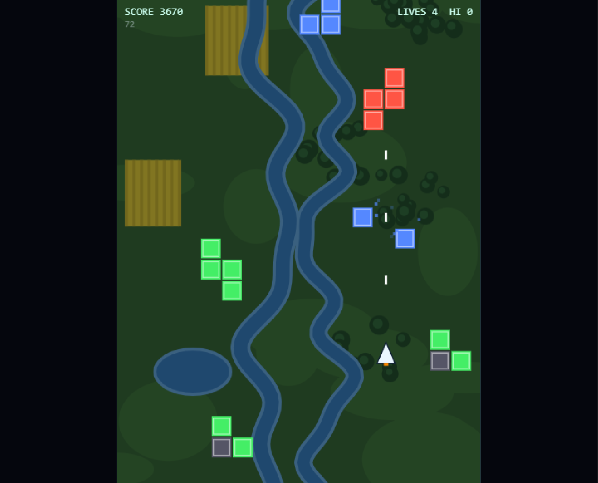

# Tetrovious

Destroy Tetris block-inspired enemies, survive increasingly difficult stages, and progress through dynamically themed environments with procedurally generated backgrounds and adaptive music.

## Play Online
 
🎮 **Play Tetrovious in your browser**
 
[https://olaelias.github.io/Tetrovious/](https://olaelias.github.io/Tetrovious/)

## Features

- Pure HTML, CSS, and JavaScript
- No external dependencies
- HTML5 Canvas rendering
- Tetris-inspired enemy formations
- Keyboard and touch controls
- Procedural stage environments
- Dynamic synthesized soundtrack
- Retro arcade gameplay
- Responsive fullscreen scaling

## Controls

| Action | Keys |
|---------|------|
| Move | WASD / Arrow Keys |
| Fire | Space / Z |
| Precision Move | Left Shift |
| Pause | Enter |

## Running

Open `Tetrovious.html` in any modern web browser.
